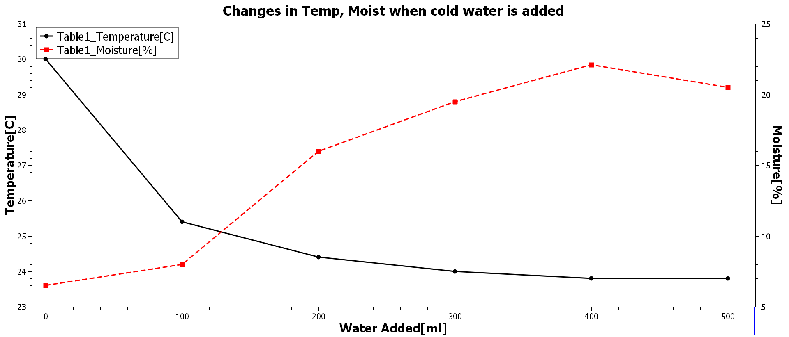
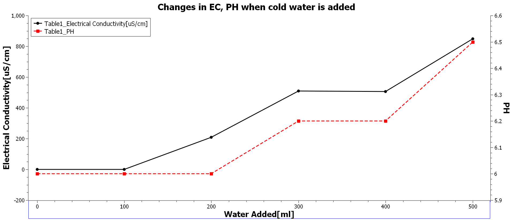
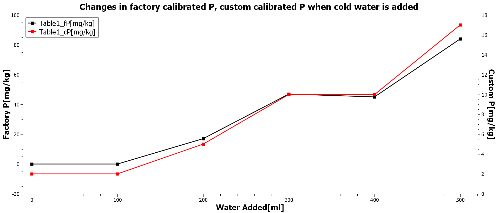
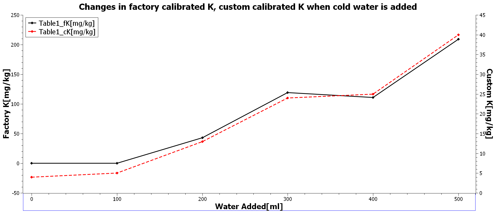

# Advanced Soil Sensing & Algorithmic NPK Calibration System

An embedded data acquisition system built on the ATmega328P (Arduino Uno) that interfaces with an industrial 5-pin RS485 Soil Sensor (Model 485) via a custom register-level Modbus RTU implementation. 

Instead of relying solely on the sensor's static factory macronutrient estimations—which are skewed by moisture and temperature fluctuations—this project implements a real-time Temperature Stabilization and Multiple Linear Regression (MLR) model on the microcontroller to compute compensated Nitrogen (N), Phosphorus (P), and Potassium (K) indices.

## Key Features

* **Bare-Metal Modbus RTU & UART:** Bypasses standard communication libraries by manipulating internal ATmega328P registers (`UBRR0H`, `UCSR0B`, `UDR0`, `DDRD`, `PORTD`) for deterministic 9600 bps communication and low overhead.
* **Custom CRC-16 Checksum:** Validates incoming 19-byte Modbus sensor payloads using bitwise XOR and shift operations.
* **Algorithmic NPK Compensation:** Normalizes bulk Electrical Conductivity to 25°C ($EC_{25}$) and feeds it alongside volumetric moisture ($\theta_v$) into a Multiple Linear Regression (MLR) model.
* **Non-Blocking Multi-Page UI:** Uses a 50 ms software-debounced push-button and a 3000 ms polling timer to cycle a 1602A LCD through 4 views:
  1. Temperature (°C) & Volumetric Moisture (%)
  2. Electrical Conductivity (uS/cm) & interpolated pH
  3. Factory Modbus-reported N, P, K (mg/kg)
  4. Custom Calibrated cN, cP, cK (mg/kg)

## Hardware & Pin Mapping

| Component | Pin / Terminal | Connection / Arduino Pin | Notes |
| :--- | :--- | :--- | :--- |
| **Model 485 Sensor** | VCC / GND | +12V DC / Common GND | Isolated 12V supply (share GND with Arduino) |
| | Data A (+) / Data B (-) | MAX485 `A` / MAX485 `B` | Differential RS485 pair |
| **MAX485 Module** | `TXD` / `RXD` | `D1 (TX)` / `D0 (RX)` | Hardware USART (disconnect when flashing) |
| | `VCC` / `GND` | +5V Rail / Common GND | 5V TTL Logic |
| **1602A LCD** | `RS`, `E`, `D4`-`D7` | `D7`, `D8`, `D9`-`D12` | 4-bit parallel mode (`lcd(7, 8, 9, 10, 11, 12)`) |
| **Push-Button** | Terminal 1 / Terminal 2 | `D4` (`PD4`) / Common GND | Uses internal hardware pull-up resistor |

**Note on Flashing:** Because the MAX485 uses hardware UART pins (`D0`/`D1`), temporarily disconnect the TX/RX lines before uploading new firmware via USB.

## Algorithmic Calibration Model

Solid-state 5-pin sensors apply a static linear multiplier to raw apparent electrical conductivity ($EC_a$), causing false nutrient spikes when dry soil is watered. To compensate:

1. **Thermal Standardization ($EC_{25}$):** Raw conductivity ($EC_t$) is normalized to 25°C using $\alpha \approx 0.019\text{ }^\circ\text{C}^{-1}$:
   $$EC_{25} = \frac{EC_t}{1 + 0.019(T - 25)}$$

2. **Multiple Linear Regression (MLR):** Standardized conductivity and volumetric moisture ($\theta_v$) are mapped to a composite Macronutrient Index ($N_{idx}$):
   $$N_{idx} = \beta_0 + \beta_1(EC_{25}) + \beta_2(\theta_v) + \beta_3(EC_{25} \cdot \theta_v)$$

## Experimental Measurements & Results

The pipeline was validated by adding 500 ml of cold water in 100 ml increments to a dry soil sample to evaluate the sensor's transient response and the ATmega328P's local regression model.

### 1. Raw Environmental Transients
As cold water was introduced, soil temperature dropped from 30.0°C to 23.8°C while volumetric moisture rose from 6% to 22%. Dissolving ionic salts caused Electrical Conductivity (EC) to spike from 0 to over 800 uS/cm, shifting interpolated pH from 6.0 to 6.5.

### 2. Factory vs. Custom Calibrated NPK
Because factory firmware applies a static multiplier to raw EC, hydration caused false macronutrient spikes (e.g., factory Potassium jumping from 0 to >200 mg/kg in a sealed sample). The local MLR model extracted the raw registers and constrained the outputs to realistic agronomic ratios (shown on the right Y-axes).

*(See [`Docs/images/fN_cN.png`](Docs/images/fN_cN.png) for the Nitrogen comparison curve).*

## Getting Started

1. Clone the repository and open the firmware file in the Arduino IDE (or compile via `avr-gcc`).
2. Disconnect `D0` and `D1`, flash the firmware to the Arduino Uno, and reconnect the serial lines.
3. Tune the regression coefficients (`beta0` through `beta3`) in the source code based on laboratory baseline testing of your target soil sample.

## Future Roadmap

* **IoT Telemetry:** Upgrade to an ESP32 for cloud dashboard logging.
* **Empirical Calibration:** Derive site-specific $\beta$ weights via laboratory mass spectrometry.
* **Closed-Loop Actuation:** Add solid-state relays to control solenoid valves and fertilizer pumps.
* **Solar Power Management:** Consolidate 12V and 5V rails into a battery-backed solar circuit with deep-sleep polling.

## Author

Fazakas David-Antal
